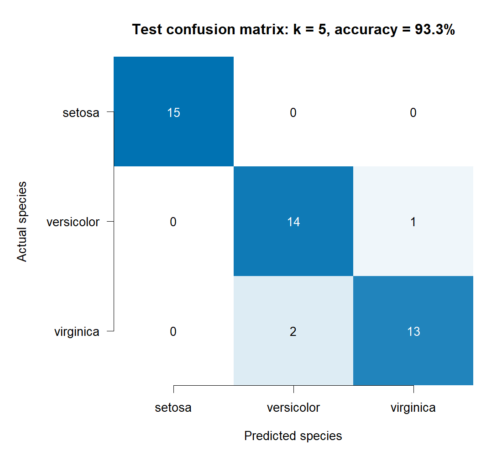

```{r setup, include=FALSE}
knitr::opts_chunk$set(echo=TRUE, warning=FALSE, message=FALSE)
source("iris_analysis.R", local=knitr::knit_global())
```

# Introduction
The Iris dataset records sepal length, sepal width, petal length and petal width for 150 flowers. The measurements are in centimetres. This project uses R to compare the three species and check how well a k-NN model can predict them.

# Data import and exploration
```{r exploration}
head(iris)
str(iris)
summary(iris)
colSums(is.na(iris))
sum(duplicated(iris))
table(iris$Species)
```
There are 50 flowers from each species and no missing values. One row is repeated. It is kept because two flowers can share the same measurements when the values are rounded to one decimal place.

# Visualisations
```{r figures, echo=FALSE, out.width="95%"}
knitr::include_graphics(c("results/pairplot.png", "results/boxplots.png", "results/histograms.png", "results/correlation.png"))
```
Setosa stands out in the petal plots, while versicolor and virginica overlap. Their median petal lengths are 1.50, 4.35 and 5.55 cm, respectively. Setosa has the widest sepals. Petal length and petal width tend to increase together, with a correlation of about 0.963 across all 150 flowers.

# Statistical summary
```{r statistics}
knitr::kable(stats, digits=3)
by_species
```
The table uses the sample standard deviation, calculated with n - 1 in the denominator. Petal measurements vary more relative to their means than sepal measurements do. Much of this difference comes from the gap between species. For petal length, the mean is 3.758 cm and the median is 4.350 cm. The small setosa petals pull the overall mean down.

# Methodology and classification
Using set.seed(42), the data are split into 35 training flowers and 15 test flowers for each species. The training means and standard deviations are used to scale both sets, so the test data do not affect this step. The model uses k = 5, chosen before looking at the test results. It predicts the species that appears most often among the five nearest training flowers, using Euclidean distance.

```{r performance}
k
nrow(train)
nrow(test)
accuracy
cm
```
Test accuracy is `r sprintf("%.1f%%",100*accuracy)` (`r sum(diag(cm))` of `r sum(cm)` flowers). All 15 setosa test flowers are classified correctly. One versicolor flower is labelled as virginica, and two virginica flowers are labelled as versicolor. These are the species that overlap in the plots.

```{r confusion-plot, echo=FALSE, out.width="80%"}

```

# Conclusion
The petal measurements give the clearest differences between species. With k = 5, the model gets 42 out of 45 test flowers right, or 93.3%. The result is encouraging, but the test set is small: one extra error would change the accuracy by 2.22 percentage points. Repeating the split and comparing k-NN with another classifier would help check how stable the result is. A further question is whether petal length and petal width alone would be enough.

# R code
```{r full-source, eval=FALSE, code=readLines("iris_analysis.R")}
```

# Software and data
Data: built-in R datasets::iris; model: class::knn.
```{r session}
sessionInfo()
```
